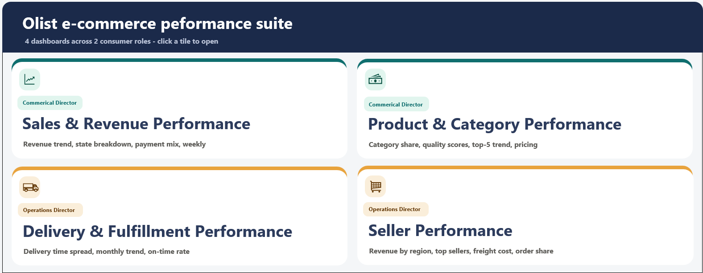

# 🛒 Project 1: Retail & E-Commerce (Olist)

**Business question:** What drives customer satisfaction and revenue for a large online marketplace, and where is the business losing customers?

## 📦 Dataset
**Olist Brazilian E-Commerce** (public, Kaggle): ~100,000 orders from 2016–2018 across multiple related tables (orders, items, payments, reviews, customers, sellers, products), combined into a Power Pivot data model.

## 🔍 Key Findings
- **Delivery speed drives satisfaction:** late deliveries averaged **~2.6 review stars**, compared with **~4.3** for orders delivered on time, making logistics the biggest lever on customer experience.
- The dashboard breaks performance down by product category, region, seller and payment method, so each team can see where its own problems sit.

## 🛠️ What I Built
- A **multi-table Power Pivot data model** with relationships across the Olist tables
- A **homepage** with navigation to four themed dashboards
- KPI cards, pivot charts and slicers for filtering by date, category and region
- A documented **data cleaning log** covering every transformation made to the raw data

## 📸 Dashboards

   
   

## 📁 Files
| File | Description |
|---|---|
| `Olist Retail & E-Commerce Project - Mustafa Malik.xlsb` | The full workbook (saved as .xlsb to reduce file size) |
| `Olist_Data_Cleaning_Log.pdf` | Step-by-step record of data cleaning and preparation |

**Tools:** Excel, Power Pivot, Power Query, pivot tables, slicers
