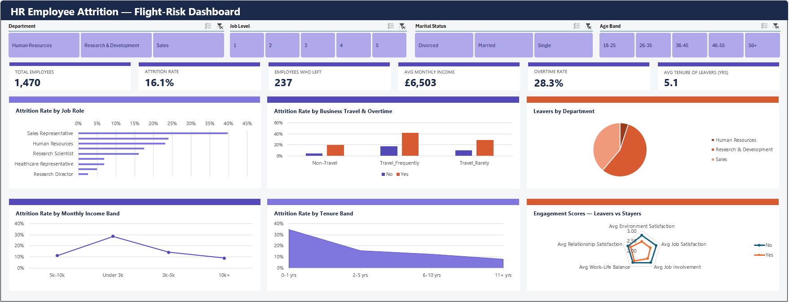

# 👥 Project 2: Employee Attrition (IBM HR Analytics)

**Business question:** Why are employees leaving, and which groups are most at risk?

## 📦 Dataset
**IBM HR Analytics Employee Attrition** (public, Kaggle): 1,470 employees with 35 attributes, including department, role, pay, overtime, satisfaction scores, tenure and whether the employee left.

## 🔍 Key Findings
- Overall attrition was **~16%** (237 of 1,470 employees).
- **Overtime is the strongest single signal:** employees working overtime left at **~31%**, roughly **3x** the rate of those who didn't (**~10%**).
- The dashboard lets HR compare attrition across departments, job roles, age bands, income levels and satisfaction scores to target retention efforts.

## 🛠️ What I Built
- A single-page interactive attrition dashboard with KPI cards, pivot charts and slicers
- Calculated fields and banding (e.g. age and income bands) to make patterns easier to read
- A **data preparation log** documenting checks and transformations on the raw data

## 📁 Files
| File | Description |
|---|---|
| `Project 2 - IBM HR Employee Attrition - Mustafa Malik.xlsx` | The full workbook |
| `IBM_HR_Attrition_Data_Prep_Log.pdf` | Data preparation and quality-check log |

**Tools:** Excel, pivot tables, calculated fields, slicers
