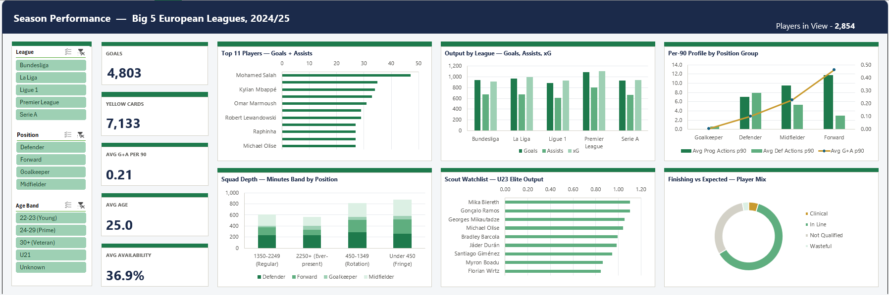

# ⚽ Project 3: Sports Analytics (Big 5 European Leagues 2024/25)

**Business question:** Which players and positions deliver the most output, and who are the young players worth scouting?

## 📦 Dataset
Player season statistics for the **2024/25 season across the Big 5 European leagues** (Premier League, La Liga, Bundesliga, Serie A, Ligue 1): **2,854 players** with goals, assists, expected goals (xG), minutes, cards and per-90 metrics.

## 🔍 Key Findings
- Across the leagues: **4,803 goals**, **7,133 yellow cards**, an average player age of **25.0** and an average of **0.21 goals + assists per 90**.
- **Mohamed Salah** led all players for combined goals and assists by a clear margin.
- The **Premier League** recorded the highest goals and xG of the five leagues.
- **Forwards** average roughly **0.45 G+A per 90**, while **defenders and midfielders lead on progressive and defensive actions**, showing how differently each position contributes.
- Average availability of only **36.9%** shows most squad players get limited minutes; the squad depth chart splits players into regular, rotation and fringe bands.
- A **U23 scout watchlist** surfaces high-output young players, led by **Mika Biereth**.

## 🛠️ What I Built
- A single-page scouting dashboard with slicers for **league, position and age band**
- KPI cards, top-player rankings, per-90 position profiles and a combo chart (bars plus line on a secondary axis)
- A **finishing vs expected** breakdown classifying players as clinical, in line or wasteful based on goals vs xG
- Minutes banding to analyse squad depth by position

## 📁 Files
| File | Description |
|---|---|
| `Project 3 - Sports Analytics - Mustafa Malik.xlsx` | The full workbook |

**Tools:** Excel, pivot tables, calculated fields, combo charts, slicers
