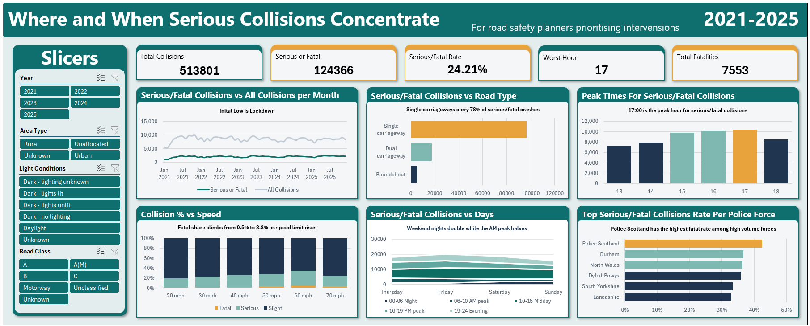

# 🚗 Project 5: UK Road Safety (DfT STATS19)

**Business question:** When, where and under what conditions do road collisions happen in Great Britain, and where should road-safety efforts be focused?

## 📦 Dataset
**STATS19 Road Safety Data** from the UK Department for Transport (gov.uk): around **five years** of police-reported road collisions, combining collision, vehicle and casualty records. This is official government data at large scale, which required careful modelling to keep the workbook usable.

## 🔍 Key Findings
See the full **project report** (`UK_Road_Safety_Project_Report.pdf`) for the complete analysis and findings.

## 🛠️ What I Built
- A **Power Pivot data model** linking collision, vehicle and casualty tables
- An interactive dashboard with KPI cards, trend charts and slicers to explore collisions by time, location, severity and conditions
- A written project report presenting the analysis and recommendations

## 📁 Files
| File | Description |
|---|---|
| `UK_Road_Safety_Project_Report.pdf` | Full project report |
| Excel workbook | **[Download from Releases](https://github.com/MustafaMalik21-dev/Data-Analytics-Portfolio/releases)** (too large to store in the repo) |

**Tools:** Excel, Power Pivot, Power Query, pivot charts, slicers
