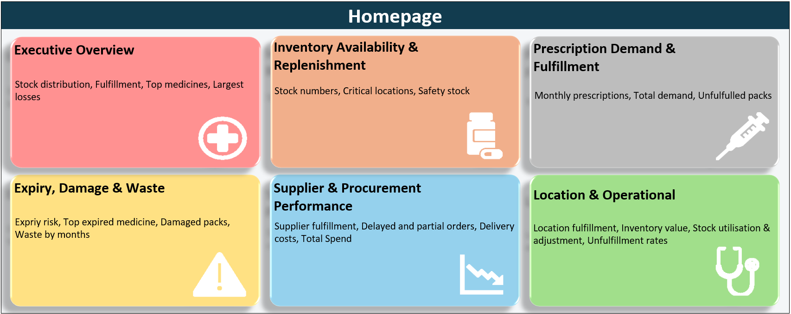

# 💊 Project 6: UK Prescription Medicine (Pharmacy Operations)

**Business question:** Are pharmacies across the UK meeting prescription demand, and where are stock, waste and supplier problems putting patients at risk?

## 📦 Dataset
A UK pharmacy operations dataset covering **12 months (Jul 2025 – Jun 2026)** across **15 hospital and community pharmacies** in NHS health regions in England, Scotland, Wales and Northern Ireland. It includes prescriptions, inventory, expiry, supplier orders and location data.

## 🔍 Key Findings
- **Pharmacies fulfil 96.9% of prescribed packs** (193,903 of 200,122), leaving **6,219 packs unfulfilled**.
- **Suppliers are the real bottleneck:** overall supplier fulfilment is only **72.6%**, and every supplier falls short of its reliability target. **NorthStar Cardiovascular Logistics** has the most delayed (49) and partial (66) orders.
- **Cardiovascular medicines are the pressure point across the whole operation:** the highest inventory value (**£103k**), the most unfulfilled packs, the most expired packs and the highest expiry losses.
- **Waste is well controlled** at a **0.49%** waste rate (**£2,256** expiry loss), but **24 items** are at risk of expiring within 30 days.
- The **North West** and **Midlands** have the most unfulfilled packs, and **Liverpool Riverside Pharmacy** has the lowest fulfilment rate (**95.1%**).

## 🛠️ What I Built
A **homepage with navigation buttons** linking to six themed dashboards, each aimed at a different stakeholder:
1. **Executive Overview**: headline KPIs for leadership
2. **Inventory Availability & Replenishment**: reorder needs, critical stock and safety stock
3. **Prescription Demand & Fulfilment**: prescribed vs dispensed, urgent demand and NHS vs private split
4. **Expiry, Damage & Waste**: expiry risk, waste trends and damaged packs
5. **Supplier & Procurement Performance**: fulfilment vs target, delays, costs and spend
6. **Location & Operational Performance**: pharmacy rankings, regional gaps and storage use

## 📸 Dashboards

   
   
   

## 📁 Files
| File | Description |
|---|---|
| `Project 6 - UK Prescription Medicine - Mustafa Malik.xlsx` | The full workbook |

**Tools:** Excel, pivot tables, KPI cards, slicers, conditional formatting, hyperlinked navigation
